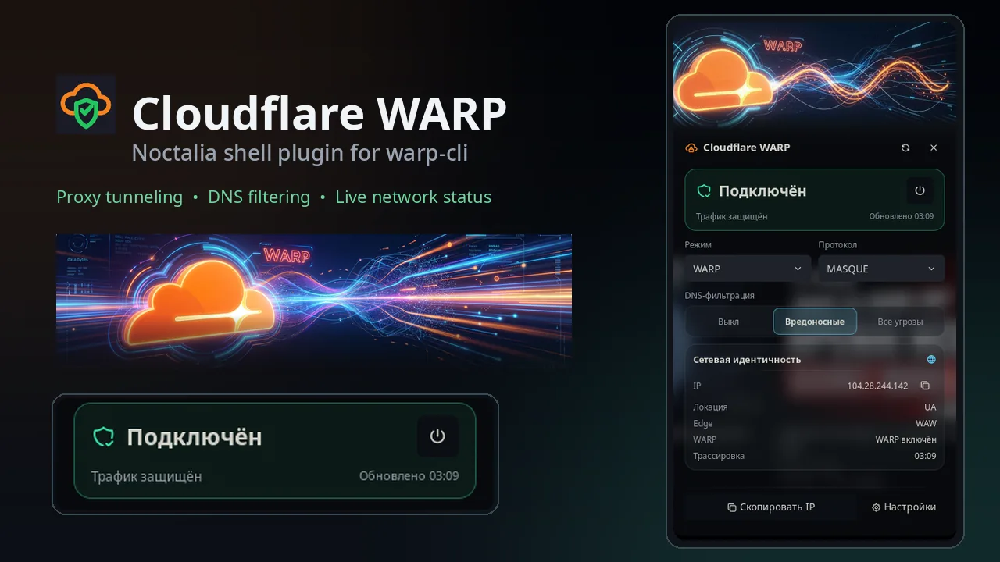

# Cloudflare WARP — Noctalia plugin

Control Cloudflare WARP from the Noctalia bar, Control Center and a dedicated panel.
A headless service is the single source of truth: it polls `warp-cli`, publishes one
`warp.status` state table, and executes whitelisted mutations from IPC and the UI.
Everything else — bar widget, Control Center tile, panel — is a live renderer that
never touches the CLI or the network itself.

## Features

- **Bar widget** — per-phase SVG icon, short status text and a detail tooltip;
  left click opens the panel, right click toggles WARP.
- **Control Center tile** — live label/active/enabled state; left click toggles,
  right click refreshes.
- **Panel** — full control surface: animated status banner, hero card with power
  button, mode and protocol selects, DNS Families segments, network identity
  (egress IP, location, edge, WARP flag, trace time), register and copy-IP actions.
- **Notifications** — connected/disconnected notifications and error notifications,
  both optional; transitional phases are held until the tunnel settles, so the UI
  never flashes back to a stale state.
- **Network identity tracking** — a lightweight `cdn-cgi/trace` probe with an
  adjustable interval, a follow-up probe right after connect/disconnect/mode or
  protocol changes, and a circuit breaker that pauses probing after repeated
  failures (a manual refresh clears it).
- **Full i18n** — English and Russian, following the host language.

## Dependency

The plugin requires Cloudflare's official `cloudflare-warp` package, which provides
`warp-cli` and the `warp-svc` daemon:

- <https://developers.cloudflare.com/warp-client/get-started/linux/>

WARP itself must already be installed, and registering the client is an interactive,
browser-based sign-in flow owned by Cloudflare. The plugin never runs `sudo`,
`pkexec` or `systemctl`; it works through the user-facing CLI only.

### Terms of service

Every `warp-cli` invocation passes `--accept-tos`. This means the plugin accepts
Cloudflare's WARP terms of service **on your behalf**; review them before enabling the
plugin.

## Installation

Install from the Noctalia plugin store once published, or run this repository as a
local path source:

```bash
noctalia msg plugins source add warpdev path /path/to/cloudflare-warp-plugin
noctalia msg plugins list | grep cloudflare-warp
noctalia msg plugins enable ModernByte/cloudflare-warp
```

The repository root is the plugin source; the plugin itself lives in the
`cloudflare-warp/` directory (the suffix of its id). To remove the development
source later:

```bash
noctalia msg plugins disable ModernByte/cloudflare-warp
noctalia msg plugins source remove warpdev
```

## Configuration

| Setting | Default | What it does |
|---------|---------|--------------|
| `poll_interval_ms` | 3000 | How often the service polls `warp-cli status`. |
| `notify_on_change` | on | Connected / disconnected notifications. |
| `notify_on_error` | on | Error notifications (CLI-missing is excluded). |
| `auto_trace` | on | Periodic `cdn-cgi/trace` probe for network identity. |
| `trace_interval_s` | 60 | Trace probe interval (visible only with `auto_trace`). |
| `show_text_in_bar` (widget) | on | Status text next to the bar icon. |
| `compact_mode` (widget) | off | Icon only, no text. |

## Panel

The panel opens with a left click on the bar widget or via
`noctalia msg panel-toggle ModernByte/cloudflare-warp:panel`. Layout, top to
bottom: animated full-bleed banner (plays a colour ramp forward when the tunnel is
up and in reverse on disconnect, and sits on a desaturated first frame while WARP is
off, so the banner always matches the phase), header with refresh and close, hero
card with phase status and power button, Mode and Protocol selects (Mode is
disabled while a policy lock is active), DNS filtering segments, network identity
card, and a footer with Copy IP / Register and Settings.

Every panel action is written to the `warp.command` state channel and executed by
the service. The panel is a renderer and command writer only: no `runAsync`, no
HTTP, no CLI calls and no `warp.status` writes. Long IPv6 addresses are
middle-truncated in the display but copied in full. The panel does not show the
`warp-cli` version.

### Interactions

| Surface | Left click | Right click |
|---------|-----------|-------------|
| Bar widget | Open the plugin panel | Toggle WARP |
| Control Center tile | Toggle WARP | Refresh status |

Toggle is ignored while the service reports `busy`, and the tile is disabled while
`warp-cli` is unavailable or a command is in flight.

### Warnings

- Changing the **protocol** restarts the WARP tunnel and briefly drops
  connectivity; the plugin does not block the change.
- **Register** runs the interactive `warp-cli registration new`: it waits up to
  30 seconds for the browser sign-in. A timeout is reported as a "registration
  still waiting for the sign-in" notification, **not** as an error; once the
  sign-in completes, the next poll marks the client as registered.

## IPC

The service entry implements `onIpc` and also watches the `warp.command` state
channel. Both paths route into one dispatch with the same whitelist validation.
The IPC payload is a single string; a missing argument arrives as `""`, and any
rejected value is logged as a warning and skipped — no CLI call, no state change.

| Action | Argument | What it does |
|--------|----------|--------------|
| `toggle` | — | Disconnect when connected/connecting, otherwise connect. |
| `connect` | — | `warp-cli connect`. |
| `disconnect` | — | `warp-cli disconnect`. |
| `refresh` | — | Out-of-order status + settings + registration + trace probe. |
| `register` | — | Interactive `registration new` (up to 30 s browser wait). |
| `set-mode` | one of `warp`, `doh`, `warp+doh`, `dot`, `warp+dot`, `proxy`, `tunnel_only` (exact case) | `warp-cli mode <M>`; refused while the client reports a locked switch. |
| `set-families` | one of `off`, `malware`, `full` (exact case) | `warp-cli dns families <F>`. |
| `set-protocol` | `wireguard` or `masque`, any case | `warp-cli tunnel protocol set <P>`. |

```bash
noctalia msg plugin ModernByte/cloudflare-warp:service all refresh
noctalia msg plugin ModernByte/cloudflare-warp:service all toggle
noctalia msg plugin ModernByte/cloudflare-warp:service all connect
noctalia msg plugin ModernByte/cloudflare-warp:service all disconnect
noctalia msg plugin ModernByte/cloudflare-warp:service all register
noctalia msg plugin ModernByte/cloudflare-warp:service all set-mode warp+doh
noctalia msg plugin ModernByte/cloudflare-warp:service all set-families malware
noctalia msg plugin ModernByte/cloudflare-warp:service all set-protocol MASQUE
```

UI entries do not call IPC from scripts; they write a table (`seq`, `action`,
optional `mode`/`families`/`protocol`, optional `source`) to the `warp.command`
channel and the service consumes it.

## Known limitations

- **DNS Families is write-only in the CLI.** `warp-cli dns families` has no getter,
  so the plugin cannot read the current value. The panel therefore shows the
  Cloudflare default **Malware** until a value is set in the current service
  session; after a restart it shows *Malware* again even though the client keeps
  the last applied setting. A selection applies immediately and cannot be read
  back or reverted by the plugin.
- **Control Center tile is glyph-only.** `shortcut.setIcon` accepts Tabler glyph
  names, not image paths, so the tile uses `cloud-lock` / `cloud-off` while the
  bar shows custom phase SVG icons.
- **Widget clicks:** left button opens the panel, right button toggles WARP
  (the opposite of what you might expect from other widgets — the tile in Control
  Center uses left click for toggle).
- **SVG icon fallback:** if a phase SVG asset is missing at runtime, the bar
  widget falls back to a Tabler glyph and logs a single warning per entry
  lifetime.
- **Trace probe transport:** on some hosts the HTTP client times out against
  `cdn-cgi/trace` (notably when WARP itself tunnels the request), so the plugin
  prefers an argv-only `curl` when it is on `PATH` and uses the host HTTP client
  as a fallback. Repeated probe failures trip a circuit breaker that pauses
  automatic probing with exponential backoff; a manual refresh runs a probe
  immediately and clears the breaker.
- The transitional `connecting` / `disconnecting` phase is held until a status
  poll confirms the target (with a 30 s safety timeout), because `warp-cli`
  returns before the tunnel actually settles.

## Network and processes

Every `warp-cli` call is an argv vector prefixed with `--accept-tos --json
--no-paginate --no-ansi` and launched through the argv form of
`noctalia.runAsync(..., cb, timeoutMs)` with a per-command timeout;
`warp-cli --version` is the only call without the base flags. Nothing is run
through a shell, no shell strings, no `grep`/`awk`, no `os.execute`, no
`io.popen`, no `sudo`. This is the complete list:

| Call | When | Data |
|------|------|------|
| `warp-cli status` (argv) | every poll tick (default 3 s), on enable, on `refresh`, and right after every mutation resolves | local CLI, no payload |
| `warp-cli settings list` (argv) | every 5th poll tick, on `refresh`, and after connect/disconnect/mode/protocol mutations | local CLI, no payload |
| `warp-cli registration show` (argv) | every 10th poll tick, on `refresh`, and after `registration new` | local CLI, no payload |
| `warp-cli registration new` (argv) | IPC / `warp.command` action `register` | local CLI; prints the Cloudflare sign-in URL, up to 30 s interactive wait |
| `warp-cli connect` (argv) | action `connect`, and `toggle` when the phase is not connected/connecting | local CLI, no payload |
| `warp-cli disconnect` (argv) | action `disconnect`, `toggle` when connected/connecting, and the panel power button during a held transition | local CLI, no payload |
| `warp-cli mode <M>` (argv) | action `set-mode`; `<M>` whitelisted | local CLI, whitelisted mode |
| `warp-cli dns families <F>` (argv) | action `set-families`; `<F>` whitelisted | local CLI, whitelisted families |
| `warp-cli tunnel protocol set <P>` (argv) | action `set-protocol`; `<P>` whitelisted | local CLI, whitelisted protocol |
| `warp-cli --version` (argv) | once on service start | local CLI, no payload |
| `curl --silent --show-error --fail --max-time 10 --connect-timeout 5 https://www.cloudflare.com/cdn-cgi/trace` (argv) | trace probe: every `trace_interval_s` while `auto_trace`, on `refresh`, and ~5 s after a successful connect/disconnect/mode/protocol change; preferred when `curl` is on `PATH` | HTTPS GET to Cloudflare; response parsed locally for status/IP/location/edge only |
| `noctalia.http` GET `https://www.cloudflare.com/cdn-cgi/trace` | same trace probe, fallback when `curl` is not on `PATH` | same parser, circuit breaker and in-flight guard as the curl path |

The trace probe is the plugin's only network call: your public egress IP is sent
to Cloudflare as part of the standard `cdn-cgi/trace` response exchange. No other
subprocesses, shells or network endpoints are used.



More states and the full visual system live in the source repository
(`docs/DESIGN-PANEL.md`).

## Icons and trademarks

`assets/icons/` contains original stylized WARP status icons (color and mono
variants). They are not the official Cloudflare logo and are not copied from
Cloudflare artwork. "Cloudflare", "WARP" and the Cloudflare logo are trademarks of
Cloudflare, Inc. This plugin is an independent community project and is not
affiliated with or endorsed by Cloudflare.

## License

MIT.
