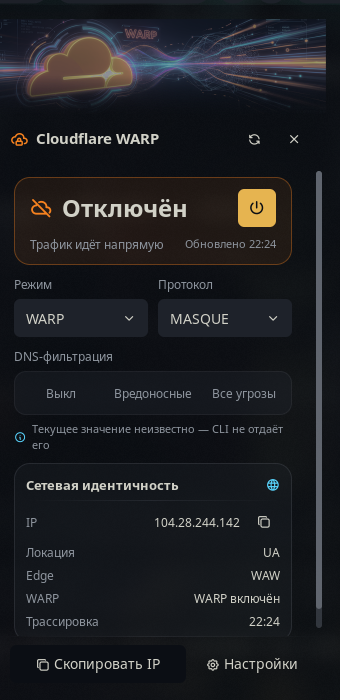
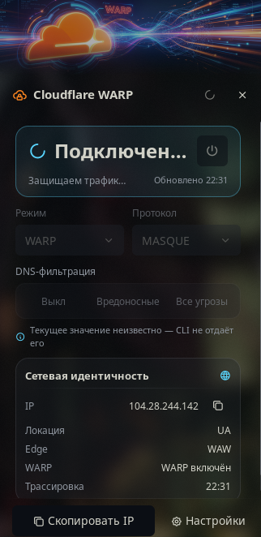
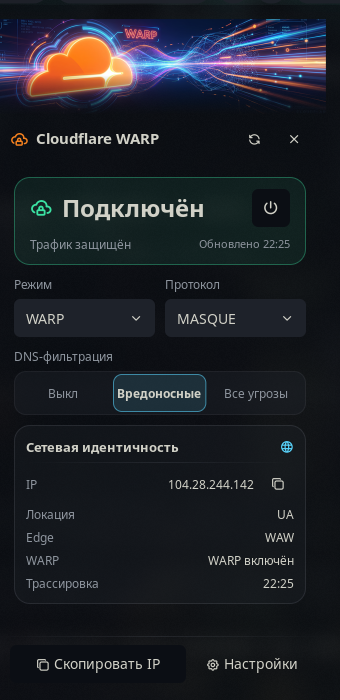
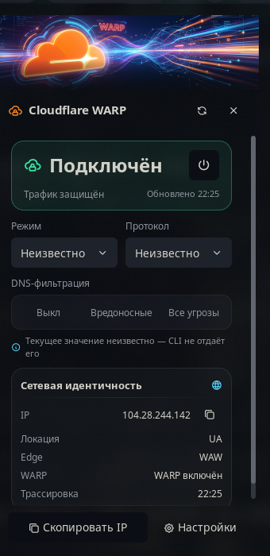
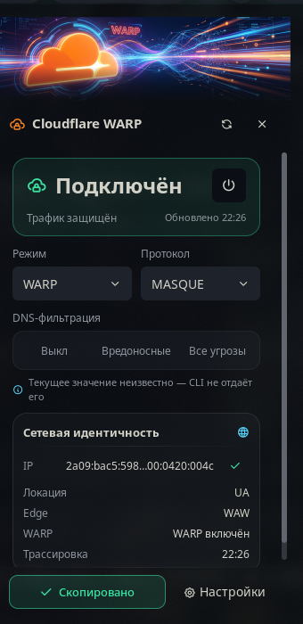
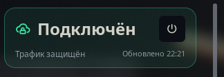
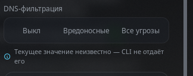

# DESIGN — панель Cloudflare WARP

**Статус:** `0.4.1` (PATCH, Phase 3). Панель переработана во вторую версию; контракт
`warp.status` / `warp.command` и IPC не менялись.
**Источник истины:** [`cloudflare-warp/panel.luau`](../cloudflare-warp/panel.luau),
[`specs/phase-3-panel-redesign.md`](../specs/phase-3-panel-redesign.md).

Панель — это network control surface, а не админская форма. Порядок чтения:
**статус → действия → детали**. Панель только рендерит состояние и пишет команды через
`State.setCommand(..., source = "panel")`; она не запускает CLI, не делает HTTP-запросов
и не пишет `warp.status`.

## Галерея

Скриншоты сняты на живом хосте Noctalia 5.3.0: основные — 340×700, `connecting` —
322×662 при том же аспекте; close-up — 324×112 и 324×128.

| Скриншот | Что показывает |
|----------|----------------|
|  | **Connected.** Полноцветный баннер, зелёный hero, крупный статус, power в режиме отключения. |
|  | **Disconnected.** Приглушённый баннер, оранжевый hero, power — primary. |
|  | **Connecting.** Баннер с opacity 0.65, циановый hero, loader в header и hero, контролы dim. |
|  | **Families selected.** Cyan низкой интенсивности, caption неизвестного значения исчезает. |
|  | **Unknown selects.** Mode и Protocol показывают честный placeholder, а не выдуманное значение. |
|  | **Copied.** Success-состояние в footer и в строке identity; IPv6 в строке сокращён, в буфере — полный. |
|  | **Hero close-up.** Фазовый акцент, статус, подзаголовок, «Обновлено HH:MM» и power. |
|  | **Families close-up.** Ни один сегмент не выбран, caption объясняет, почему значение неизвестно. |

## Карта компоновки

```
root column (gap=0, padding=0, align=stretch, flexGrow=1)
├─ banner ui.image 360×96, fit=cover, opacity по фазе
├─ header row (paddingH=16, paddingV=8, gap=8)
│   ├─ glyph cloud-lock 18, brand-orange
│   ├─ label «Cloudflare WARP» 15 bold
│   ├─ spacer flexGrow=1
│   ├─ Refresh (ghost, refresh | loader-2)
│   └─ Close (ghost, close)
├─ ui.scroll (flexGrow=1, gap=10, paddingH=16, paddingV=6)
│   ├─ hero card (radius=16, paddingH=16, paddingV=12)
│   │   ├─ row: status glyph 22 + status 24 bold + power
│   │   ├─ row: subtitle 12 + «Обновлено HH:MM» 11
│   │   └─ error only: код ошибки 11 + message 11
│   ├─ controls row (gap=10): Mode | Protocol, два равных столбца
│   ├─ optional caption: mode locked
│   ├─ families: label + segmented track + unknown caption
│   └─ identity card (radius=16, padding=12, gap=5)
│       ├─ title 13 semibold + glyph world 14 cyan
│       ├─ separator outline/0.25
│       └─ IP (+copy), Location, Edge, WARP, Traced
├─ separator outline/0.25
└─ footer actions (paddingH=16, paddingV=8, gap=8)
    ├─ Copy IP (outline) | Register (primary, пока не зарегистрирован)
    └─ Settings (ghost)
```

Banner занимает всю ширину и имеет нижний alpha-fade, зашитый в PNG; верхние углы
скругляет хост. Контент прокручивается внутри `ui.scroll`, footer остаётся на месте.
Версия `warp-cli` в панели не показывается, дублирующей кнопки закрытия нет.

## Фазы и акценты

| Фаза | Акцент | Баннер | Opacity | Подзаголовок (ru) |
|------|--------|--------|---------|-------------------|
| `connected` | success | color | 1.0 | Трафик защищён |
| `disconnected` | brand-orange | idle | 1.0 | Трафик идёт напрямую |
| `connecting` | cyan | color | 0.65 | Защищаем трафик… |
| `disconnecting` | cyan | color | 0.65 | Снимаем защиту… |
| `unregistered` | warning | idle | 0.9 | Клиент не зарегистрирован |
| `error` | danger | idle | 0.85 | Команда завершилась ошибкой |
| `unavailable` | danger | idle | 0.85 | warp-cli не найден в PATH |
| `unknown` | neutral | idle | 0.85 | Состояние неизвестно |

Hero fill — акцент с alpha `14`, border — с alpha `66`. Power: для `connected`,
`connecting` и `disconnecting` — `outline` и «Отключить WARP», иначе `primary` и
«Подключить WARP»; кнопка disabled при `busy`, `available = false`, `registered = false`,
`unregistered` или `unavailable`. Mode дополнительно disabled при `switchLocked`.
Ошибка дополнительно показывает `error.<code>` и `status.message`.

## Цветовая система

| Токен | Значение | Назначение |
|-------|----------|------------|
| background | host-owned | Фон панели задаёт хост; плагин его не переопределяет. |
| surface card | `surface_variant/0.35` | Карточка network identity. |
| surface track | `surface_variant/0.45` | Трек segmented-контрола Families. |
| border card | `outline/0.35` | Рамки карточек. |
| border track | `outline/0.25` | Трек Families, separator. |
| brand orange | `#F6821F` | Glyph в header, акцент disconnected. |
| brand warm | `#FFA53B` | Тёплый highlight, только малые площади. |
| cyan | `#59D6FF` | Акцент connecting/disconnecting, data-glyph, выбранный Families. |
| success | `#3BE3A3` | Акцент connected, подтверждение копирования. |
| danger | `#FF5C6C` | Акцент error/unavailable и текст ошибки. |
| warning | `#FFB340` | Акцент unregistered. |
| neutral | `#8A93A6` | Акцент unknown. |
| text primary | `on_surface` | Заголовки, статус, значения. |
| text secondary | `on_surface_variant` | Подписи, caption, время. |

Hex с прозрачностью — восемь цифр (`#RRGGBBAA`); role-токены — `role/0.35`.
Тёмная тема целевая, но поверхности и текст берутся из ролей, поэтому светлая тема
остаётся читаемой. Акцентные цвета задаются hex, поверхности и текст — ролями.

## Ассеты баннера

| Актив | Размер | Использование |
|-------|--------|---------------|
| `assets/hero-banner-color.png` | 720×192 (2×) | connected; connecting/disconnecting с opacity 0.65. |
| `assets/hero-banner-idle.png` | 720×192 (2×) | disconnected, unregistered, error, unavailable, unknown; opacity 0.9/0.85. |
| `assets/hero-banner.jpeg` | исходник | Не используется в UI; хранится как источник для пересборки PNG. |

Оба PNG уже содержат нижний alpha-fade (последние 80 px из 192). В панели изображение
рисуется как 360×96 с `fit = "cover"`; верхние углы обрезает хост.

## Типографика, отступы, радиусы

| Элемент | Размер / значение |
|---------|-------------------|
| Title | 15, bold |
| Hero status | 24, bold, одна строка |
| Identity title | 13, semibold |
| Section label | 12 |
| Значения и subtitle | 12 |
| Captions, updated, trace | 11 |
| Footer feedback text | 13 |
| Glyphs | 18 header, 22 hero, 14 secondary (info 12) |
| Header padding | 16 по горизонтали, 8 по вертикали |
| Content padding | 16 по горизонтали, 6 по вертикали, gap 10 |
| Hero padding | 16 / 12 |
| Identity padding | 12, gap 5 |
| Footer padding | 16 / 8, gap 8 |
| Controls / select height | 38 |
| Families segment | 38, radius 9 |
| Icon / copy hit target | 32 |
| Radii | hero и identity 16, segmented track 12, copy feedback 10; selects и кнопки — host-default |

## UX-правила

1. **Статус первым.** Hero отвечает на вопрос «что сейчас», только потом идут контролы
   и справочные данные.
2. **Один loud-акцент.** Кричит только hero. Families использует cyan низкой
   интенсивности (`#59D6FF1F` fill, `#59D6FF99` border), header glyph — маленький
   оранжевый.
3. **Честный unknown.** Неизвестное значение не маскируется: Mode/Protocol получают
   ведущую опцию «Неизвестно», Families — ни одного выбранного сегмента и caption.
   Disabled-состояния показывают opacity 0.55, а не ложное значение.
4. **Комфортные цели.** Интерактивные элементы не меньше 32 px; selects и сегменты —
   38 px; клик по Families работает по всей площади сегмента.
5. **Scroll только при необходимости.** Footer фиксирован, контент — в scroll. Высота
   700 выбрана так, чтобы штатный набор помещался без прокрутки.
6. **Обратная связь.** Copy показывает success около 1.6 с в footer и в строке IP;
   Refresh — loader около 1.5 с. Оба окна обслуживаются second ticks, которые
   выключаются, когда оба окна истекли.
7. **Длинный IPv6.** В строке показывается середина, сокращённая до ~28 символов;
   в буфер обмена всегда попадает полный адрес.
8. **Только i18n.** В `panel.luau` нет literal user-facing строк — только `noctalia.tr`.

## Особенности хоста

- **Геометрия.** `360×700` и `floating` объявлены в манифесте, но размером и позицией
  владеет хост. Пользовательский `[plugin_settings] panel_placement` может переопределить
  placement на лету; на dev-машине панель сейчас открывается как `attached`.
- **Scrollbar.** Полосу прокрутки рисует хост. Она может оставаться видимой, даже когда
  весь контент помещается; это не признак переполнения и не ошибка layout.
- **Second ticks.** Панель запрашивает их только на время copy/refresh-фидбека и
  отключает, когда оба окна закрыты. Постоянного секундного таймера нет.
- **Families write-only.** CLI не отдаёт текущее значение: до первого применения в
  сессии Families = `unknown`, после перезапуска снова `unknown`; прочитать или
  откатить выбор нельзя. Поэтому это сегменты-команды, а не select с состоянием.
- **Тема.** Плагин не задаёт фон панели и не форсирует тему; role-токены сохраняют
  контраст в светлой и тёмной теме. Скругление верхних углов баннера — тоже хост.
- **Контракт.** Любое действие — только команда в `warp.command`; запись `warp.status`,
  CLI-вызовы, `runAsync` и HTTP из панели запрещены.
